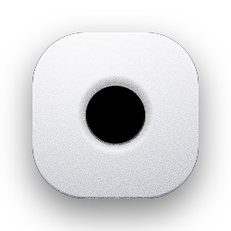

# samhq

Mac apps, designed with obsession.

[samhq.app](https://samhq.app)

## Apps

**[Hushpen](https://github.com/surajmandalcell/hushpen)**: speech-to-text dictation and file transcription that runs on your Mac, with global hotkeys and SRT subtitle export. Apple silicon, macOS 13 or later.

```sh
brew install --cask samhqapp/tap/hushpen
```

**[MacPowerToys](https://github.com/surajmandalcell/macpowertoys)**: open-source suite of small macOS utilities in one app.
